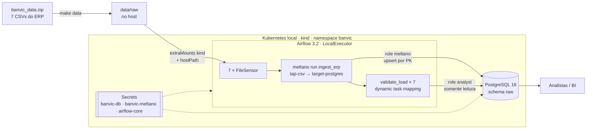

# BanVic — Pipeline de Ingestão (ELT)

Pipeline de ingestão e infraestrutura que centraliza os dados do ERP do BanVic em um PostgreSQL, usando Meltano para extração/carga e Airflow para orquestração, em Kubernetes local (kind).

## Contexto

Hoje as análises do BanVic são feitas em planilhas e apresentações, sem ferramenta de BI. A CEO quer um dashboard para a área comercial, cujo objetivo é aumentar as transações por cliente, mantê-los ativos e reduzir o churn.

Este projeto é a **fundação de dados** desse dashboard: tira as 7 tabelas do ERP de arquivos soltos e as coloca em um banco único, carregado de forma automática, verificada e segura. Um dashboard construído sobre planilhas copiadas à mão herda os erros e a defasagem delas. Com a carga automatizada e validada, os números que a área comercial vê passam a ter origem rastreável e atualização diária, e é isso que dá credibilidade ao dashboard diante de quem ainda duvida dele.

## Arquitetura



Fluxo de ponta a ponta:
1. Os CSVs ficam em `data/raw` no host, simulando o servidor on-premise do ERP. O kind monta essa pasta no nó, e um volume `hostPath` a leva até os pods do Airflow (somente leitura).
2. A DAG `banvic_ingestion` roda diariamente. Primeiro, um sensor por arquivo confirma que as 7 fontes existem.
3. O Meltano extrai os CSVs (`tap-csv`), aplica as regras de LGPD e carrega no schema `raw` do Postgres (`target-postgres`) com upsert pela chave primária.
4. Uma validação por tabela compara a contagem do CSV com a do banco e checa chaves nulas e duplicadas.

## Escolhas de ferramentas

| Camada | Escolha | Alternativa | Por quê |
|---|---|---|---|
| Cluster local | **kind** | minikube | O nó é um container Docker, sem VM: mais leve e rápido de subir. A config é um YAML versionado (IaC). Os addons do minikube não eram necessários. |
| Armazenamento | **PostgreSQL** | MinIO | Os consumidores são analistas com SQL e BI. O Postgres entrega tabelas consultáveis na hora, garante a chave primária que o upsert exige, e PowerBI e Databricks se conectam direto. MinIO seria um data lake que ainda pediria um motor de consulta (Trino, DuckDB) para 7 tabelas pequenas. |
| Ingestão | **Meltano** (Singer) | Embulk | Ecossistema com centenas de taps (os dados de CRM e marketing citados pelo negócio são as próximas fontes), Python como o Airflow, configuração declarativa, `stream_maps` para dados pessoais e suporte a carga incremental. O Embulk roda na JVM e tem comunidade menos ativa. |
| Orquestração | **Airflow 3.2** | cron, Dagster | Retries, sensores, UI, histórico de execuções e padrão de mercado. O cron não tem nada disso. Airflow 3 porque a linha 2.x saiu de suporte. |
| Executor | **LocalExecutor** | Celery, Kubernetes | Uma DAG com ~4,7 MB de dados: o paralelismo do scheduler basta. O Celery exigiria Redis e workers, e o KubernetesExecutor criaria um pod por task. Para escalar, a troca é só de configuração. |
| Execução do Meltano | **BashOperator + imagem custom** | KubernetesPodOperator | Menos peças móveis e mais fácil de depurar localmente. O custo é acoplar as dependências do Meltano às do Airflow, mitigado com um venv separado na imagem. |
| Entrega das DAGs | **Embutidas na imagem** | gitSync | Cada tag de imagem é um snapshot coerente de código e dependências. O gitSync é o padrão quando as DAGs mudam com frequência. |
| Segredos | **Kubernetes Secrets gerados do `.env`** | Vault, Sealed Secrets | Nenhum valor sensível em arquivo versionado. Em produção, a origem do `.env` passa a ser um cofre. |

## Como executar

### Pré-requisitos
- Docker com **~6 GB de RAM** para a VM (testado num Mac com 8 GB no total) e **~15 GB de disco livre** (a imagem do Airflow tem ~2,5 GB e é copiada para o nó do kind)
- [kind](https://kind.sigs.k8s.io/), kubectl e [helm](https://helm.sh/)
- O arquivo `banvic_data2026.zip` na raiz do repositório (ou indique outro caminho com `ZIP=`)

### Passo a passo

```bash
# 1. Credenciais locais (nunca versionadas)
cp .env.example .env
# preencha cada valor; o próprio .env.example indica como gerar senhas e a fernet key

# 2. Dados de origem: banvic_data2026.zip na raiz do repositório
make data                      # ou: make data ZIP=/caminho/banvic_data.zip

# 3. Cluster e aplicação
make cluster                   # cria o cluster kind "banvic"
make deploy                    # Secrets, Postgres, roles, imagem e Airflow (~10 min na primeira vez)
```

Acesse **http://localhost:8080** com `AIRFLOW_ADMIN_USER` e `AIRFLOW_ADMIN_PASSWORD`. A DAG `banvic_ingestion` começa pausada: despause e clique em **Trigger**.

Para consultar os dados carregados:

```bash
kubectl -n banvic port-forward svc/postgres 5433:5432
# conecte em localhost:5433, banco banvic, usuário analyst (somente leitura)
```

### Alvos do Makefile

| Alvo | O que faz |
|---|---|
| `make data` | Extrai o zip em `data/raw` |
| `make cluster` | Cria o cluster kind com `data/raw` montada no nó |
| `make secrets` | Cria ou atualiza os Secrets a partir do `.env` |
| `make db-roles` | Cria as roles `meltano` e `analyst` no warehouse (idempotente) |
| `make image` | Constrói a imagem do Airflow com o Meltano e a carrega no kind |
| `make airflow` | Instala ou atualiza o Airflow via Helm (chart oficial 1.22.0) |
| `make deploy` | Todos os passos acima, em ordem |
| `make clean` | Apaga o cluster |

## Estrutura

| Caminho | Conteúdo |
|---|---|
| `infra/kind/` | Configuração do cluster local |
| `infra/k8s/` | Namespace, Postgres (StatefulSet) e values do Helm do Airflow |
| `infra/sql/` | Roles do warehouse com menor privilégio |
| `meltano/` | Projeto Meltano: taps, targets, job e lockfiles dos plugins |
| `airflow/dags/` | DAG de ingestão |
| `Dockerfile` | Imagem do Airflow com Meltano, plugins e DAGs |
| `banvic_data2026.zip` | Dados de origem do ERP (fora do git) |
| `data/raw/` | CSVs extraídos do zip (fora do git) |

## Dados

### Tabelas carregadas (schema `raw`)

| Tabela | Linhas | Chave primária | Relacionamentos |
|---|---:|---|---|
| `agencias` | 10 | `cod_agencia` | — |
| `clientes` | 998 | `cod_cliente` | — |
| `colaboradores` | 100 | `cod_colaborador` | — |
| `colaborador_agencia` | 100 | `cod_colaborador`, `cod_agencia` | associa colaborador ↔ agência |
| `contas` | 999 | `num_conta` | → `clientes`, `agencias`, `colaboradores` |
| `propostas_credito` | 2.000 | `cod_proposta` | → `clientes`, `colaboradores` |
| `transacoes` | 71.999 | `cod_transacao` | → `contas` |

Total: **76.206 registros**. As transações vão de fev/2010 a jan/2023. Cada cliente tem uma conta, e cada colaborador está em uma agência.

### Decisões sobre o dado bruto
- **Tudo chega como `text`.** O CSV não traz tipos, e o tap declara todas as colunas como string. No ELT, o raw é a cópia fiel da origem, e a tipagem fica para a camada de transformação. A origem tem resíduos de ponto flutuante (ex.: `4980.2999999999993`), que devem virar `numeric(15,2)` só nessa camada.
- **Colunas `_sdc_*`** são adicionadas pelo target com o horário de extração e carga de cada linha (rastreabilidade).
- **Sinal de `valor_transacao`:** negativo para saídas (compras, Pix/TED/DOC realizados, saques, boletos) e positivo para entradas. A regra vale sem exceção para os 15 tipos de transação.

### Qualidade da origem
O cliente `528` não existe em `clientes.csv`, mas a conta `528` e 4 propostas de crédito apontam para ele. A ingestão preserva o dado como veio. O tratamento (cliente desconhecido, quarentena ou correção no ERP) é decisão da camada de transformação e do dono do dado.

## Orquestração

A DAG `banvic_ingestion` ([airflow/dags/banvic_ingestion.py](airflow/dags/banvic_ingestion.py)):

```
start → wait_<tabela> ×7 → meltano_ingest → validate_load ×7 → end
```

| Configuração | Valor | Motivo |
|---|---|---|
| `schedule` | `@daily` | O ERP exporta uma vez por dia, e o dashboard comercial não exige tempo real |
| `catchup` | `False` | Não reprocessa dias anteriores ao deploy, e a carga é full table de qualquer forma |
| `max_active_runs` | `1` | Evita duas cargas concorrentes nas mesmas tabelas |
| `retries` | 3, backoff 2× (2, 4, 8 min), teto de 10 min | Absorve falhas transitórias sem martelar o banco |
| `execution_timeout` | 30 min | Nenhuma task segura o slot indefinidamente |
| Sensores | `mode="reschedule"`, a cada 30 s, timeout de 10 min | Liberam o slot entre as verificações |
| `validate_load` | `retries=0` | Divergência de contagem é determinística, e tentar de novo só atrasaria o alerta |

## Resiliência e idempotência

**Idempotência.** O `target-postgres` usa `load_method: upsert` com a chave primária de cada tabela. Por padrão ele seria `append-only` e duplicaria os dados a cada execução. Reexecutar a DAG atualiza as mesmas linhas: a contagem não muda e só o `_sdc_batched_at` avança.

**Cenários testados:**

| Cenário | O que aconteceu |
|---|---|
| Duas execuções seguidas | Contagens idênticas (76.206) |
| `agencias.csv` ausente | `wait_agencias` ficou em `up_for_reschedule` e o Meltano **não rodou** (nenhuma carga parcial). Com o arquivo devolvido, o sensor passou em até 30 s e a execução terminou com sucesso. |
| Warehouse fora do ar (`replicas=0`) | Tentativa 1 do `meltano_ingest` falhou com `Connection refused` → `up_for_retry`. Com o banco de volta, a tentativa 2 automática carregou tudo, sem duplicar. |

## Monitoramento

O que existe:
- UI do Airflow com histórico, duração e logs de cada tentativa
- `on_failure_callback` com log estruturado (dag, task, execução, tentativa, erro) quando uma task falha de vez
- Validação pós-carga por tabela, que falha a execução se o dado divergir da origem
- Probes de readiness e liveness no Postgres, e endpoint `/api/v2/monitor/health` no Airflow

O que faltaria em produção: enviar o callback para um canal de alerta (Slack, e-mail, PagerDuty), métricas com statsd/Prometheus, logs persistidos fora do pod e SLA de horário de carga.

## Segurança

- **Nenhuma credencial versionada.** O `.env` está no `.gitignore`, e o `make secrets` gera os Kubernetes Secrets a partir dele. Manifests, DAG e `meltano.yml` só referenciam variáveis.
- **Menor privilégio no warehouse** ([infra/sql/roles.sql](infra/sql/roles.sql)):
  - `meltano` é dona do schema `raw` e não tem acesso fora dele;
  - `analyst` só lê e é usada também pela validação da DAG;
  - o superusuário fica restrito ao container do Postgres e à criação das roles.
- **LGPD na extração** (`stream_maps` no [meltano.yml](meltano/meltano.yml)):
  - CPF/CNPJ e e-mail viram `md5(salt + valor)`, que ainda servem para deduplicar e cruzar bases;
  - nome e endereço de clientes e endereço de colaboradores não são extraídos;
  - o dado pessoal nunca chega ao warehouse, e o salt fica num Secret.
- **Segredos do Airflow:** senha do banco de metadados (no lugar do default `postgres`) e chaves fernet, API e JWT fixas, no Secret `airflow-core`. A fernet key cifra as conexões salvas, e regenerá-la a cada `helm upgrade` as tornaria ilegíveis.

Faltaria em produção: cofre de segredos (Vault, AWS Secrets Manager, External Secrets), rotação de credenciais, TLS no Postgres, RBAC restringindo quem lê os Secrets, NetworkPolicies e varredura de vulnerabilidades da imagem.

## Troubleshooting

Problemas reais encontrados durante a construção:

| Sintoma | Causa | Solução |
|---|---|---|
| Montagem de `data/raw` no lugar errado | O kind resolve `hostPath` relativo ao diretório de onde é chamado | O Makefile troca `__DATA_DIR__` pelo caminho absoluto (`$(CURDIR)`) |
| `ImportError: SelfDescribing from snowplow_tracker` ao rodar `meltano` | Meltano do conda com dependência conflitante | `uv tool install meltano` em ambiente isolado |
| `File path does not exist /data/raw/...` rodando local | O `env:` do `meltano.yml` tem precedência sobre a variável do terminal | Sem default no yml: `BANVIC_DATA_DIR` vem sempre do ambiente |
| `No such command 'tap-csv'` | No Meltano 4, a sintaxe é `meltano config list <plugin>` | Ajuste do comando. O campo `version` também foi trocado por `requires_meltano`. |
| `kind load`: `no space left on device` | Disco da VM do Docker cheio, com imagem de 2,5 GB | `docker builder prune` liberou 21 GB |
| api-server reinicia no primeiro deploy | A startup probe expira enquanto as migrações do banco de metadados rodam | Nenhuma ação: estabiliza na segunda tentativa |
| Imagem nova ignorada pelo cluster | `pullPolicy: IfNotPresent` com a mesma tag | Toda mudança de imagem sobe a tag (fonte única no Makefile) |
| `retry_exponential_backoff=True` sem efeito esperado | No Airflow 3.2 o parâmetro é um multiplicador numérico | `retry_exponential_backoff: 2.0` |

## Limitações e riscos

- **Acesso aos dados comerciais.** Os dados de CRM e marketing estão com a área comercial, que ainda é cética quanto ao projeto. Pedidos de acesso podem atrasar a próxima fase. Mitigação: este piloto com dados do ERP gera valor sem depender deles; o schema separado e as roles permitem dar à área comercial controle sobre quem lê o quê; e a área participa da definição das métricas do dashboard.
- **Ambiente local.** Um nó, volume `hostPath` e LocalExecutor atendem ao desafio, mas não a produção (alta disponibilidade, dados fora do nó, escala).
- **Carga full table.** Cada execução relê os arquivos inteiros. Com o volume atual (~4,7 MB) é irrelevante, mas para fontes grandes o próximo passo é a carga incremental por data.
- **Imagem grande** (~2,5 GB), porque a imagem oficial do Airflow traz dezenas de providers. Uma imagem baseada na variante `slim` reduziria o tempo de deploy.

## Próximos passos

1. **Transformação com dbt** sobre o `raw`: tipagem, `numeric(15,2)`, timestamps, e testes de `relationships`, que já pegariam o cliente 528.
2. **Modelos para o dashboard comercial:** transações por cliente por mês, clientes ativos/inativos e sinais de churn.
3. **Novas fontes** (CRM, marketing) com taps do Meltano no mesmo pipeline.
4. **Conectar o BI** (PowerBI ou Databricks AI/BI) com a role `analyst`.
